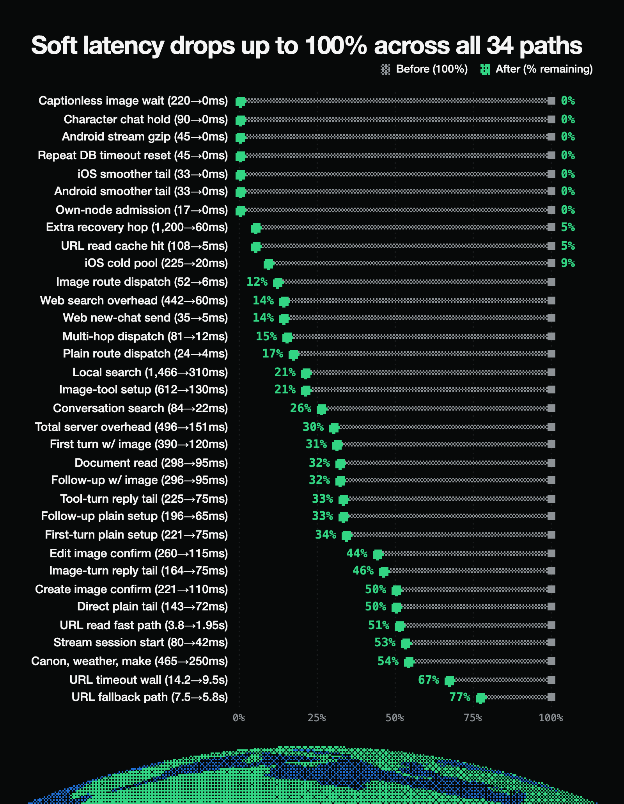

<h1 align="center">soft-latency</h1>

<p align="center">
  An agent skill that finds and cuts avoidable non-inference ("soft") latency<br>
  across server setup, streaming tails, routing, tools, database fences, and web/mobile clients.
</p>

<p align="center">
  
</p>

<p align="center"><sub>Results from applying this skill to one full-stack AI chat app. Read <a href="#what-the-numbers-mean">what the numbers mean</a> before quoting them.</sub></p>

## What it is

[`soft-latency`](skills/soft-latency/SKILL.md) is a skill for a coding agent. It separates fixed model/vendor/network floors from the overhead your own code adds, audits every layer from client tap to post-answer persistence, removes redundant round-trips and waits without weakening safety or durability invariants, and verifies every layer before reporting before-and-after numbers.

It is plain instructions in one file. There is nothing to build or run.

## Install

Clone the repo:

```bash
git clone https://github.com/kbdevs/soft-latency.git
```

For Claude Code, copy the skill into your user skills directory:

```bash
mkdir -p ~/.claude/skills && cp -R soft-latency/skills/soft-latency ~/.claude/skills/
```

For Codex:

```bash
mkdir -p ~/.codex/skills && cp -R soft-latency/skills/soft-latency ~/.codex/skills/
```

For one repo only, copy `skills/soft-latency` into that repo's `.claude/skills/` or `.agents/skills/` directory instead. Check your agent's docs if it keeps skills somewhere else.

## Try it on your app

Paste this into your coding agent. It reads and analyzes only; nothing changes until you say so.

```text
Use the soft-latency skill. Audit this app's end-to-end time to answer in read-only mode:
1. Split total latency into hard floors (model prefill/decode, external vendor APIs, wire RTT) vs. soft overhead (client/transport, server setup, routing/admission, tool wrappers, DB fences, post-answer tail). Measure time to first visible answer word separately from time to answer complete.
2. Break down the baseline by request archetype (plain, with attachments, tool calls, multi-hop) so averages do not hide slow tail paths.
3. Rank the highest-leverage soft-latency wins with exact files, estimated latency removed, and the safety, auth, billing, or durability invariants each change must preserve.
Report first. Do not edit files, deploy, or change infrastructure until I say so.
```

## What it covers

- **The right clocks.** Time to first visible answer word and time to answer complete, broken down by archetype rather than raw GPU TTFT alone.
- **Server setup.** Parallelized independent reads, side read-only DB connections, optimistic inserts with duplicate-key fallback, skipped impossible checks, and bounded in-process config memoization.
- **Post-answer tail & stateful coordinators.** Batched coordinator RPCs, trailing frames folded into `settle`, per-connection transaction reset caching, and async accounting off the serial write path.
- **Router & multi-hop dispatch.** Skipping remote admission on home capacity, stale-while-revalidate health/circuit caches, shared media grants, true incremental prefix matchers, and preventing extra recovery hops.
- **Search, URL fetch & tool wrappers.** Unledgered read-only tools, decoupled settlement drains, PoP edge caching for DNS/robots/public pages, tuned fast-path fallback handoffs, and single-connection search tools.
- **Media fences & clients.** Deduplicated transactional confirm RTTs, skipped redundant sidecar reads, unified warm mobile HTTP pools, `Accept-Encoding: identity` on SSE streams, immediate smoother idle flush, and dispatching send before route transitions.
- **Guardrails.** No weakened auth, quotas, safety screens, or erasure fences; every cross-request shared promise bounded per caller; honest separation of observed baselines vs. modeled projections.

## What the numbers mean

The chart above comes from applying this skill to one full-stack AI chat app. Treat it as an example of the method, not a universal benchmark.

- **`Before` values** come from a 72-hour production telemetry baseline (9.49M weighted turns, 2.22M tool calls, plus a 24-hour exact client-to-server join on 3.12M turns).
- **`After` values** are **modeled projections** from eliminated round-trips, waits, and fallback ceilings across locally implemented and verified changes; live production p50/p95 latency deltas are verified post-deploy.
- Rows show normalized `% remaining` (`100%` baseline down to `0–77%`) so paths spanning `17 ms` to `14.2 s` share one axis, with exact `Before → After` values in each label.
- Compare `Before` and `After` within a row. Rows cover different turn types and layers; do not add per-path savings together.
- On the full fleet average (`5.91 s` end-to-end, `1.90 s` to first visible answer word), the modeled reductions save roughly `~335 ms` (`-17%` to `-18%`) to first visible answer word and `~435 ms` (`-7.4%`) end-to-end across all turns, because model token decoding (`3.77 s`, 64%) and external vendor/wire floors are unchanged.

| Path | Before | After (modeled) | Remaining | Cut |
| --- | ---: | ---: | ---: | ---: |
| Captionless image wait | 220 ms | 0 ms | 0% | -100% |
| Character chat hold | 90 ms | 0 ms | 0% | -100% |
| Android stream gzip | 45 ms | 0 ms | 0% | -100% |
| Repeat DB timeout reset | 45 ms | 0 ms | 0% | -100% |
| iOS smoother tail | 33 ms | 0 ms | 0% | -100% |
| Android smoother tail | 33 ms | 0 ms | 0% | -100% |
| Own-node admission | 17 ms | 0 ms | 0% | -100% |
| Extra recovery hop | 1,200 ms | 60 ms | 5% | -95% |
| URL read cache hit | 108 ms | 5 ms | 5% | -95% |
| iOS cold pool | 225 ms | 20 ms | 9% | -91% |
| Image route dispatch | 52 ms | 6 ms | 12% | -88% |
| Web search overhead | 442 ms | 60 ms | 14% | -86% |
| Web new-chat send | 35 ms | 5 ms | 14% | -86% |
| Multi-hop dispatch | 81 ms | 12 ms | 15% | -85% |
| Plain route dispatch | 24 ms | 4 ms | 17% | -83% |
| Local search | 1,466 ms | 310 ms | 21% | -79% |
| Image-tool setup | 612 ms | 130 ms | 21% | -79% |
| Conversation search | 84 ms | 22 ms | 26% | -74% |
| Total server overhead | 496 ms | 151 ms | 30% | -70% |
| First turn w/ image | 390 ms | 120 ms | 31% | -69% |
| Document read | 298 ms | 95 ms | 32% | -68% |
| Follow-up w/ image | 296 ms | 95 ms | 32% | -68% |
| Tool-turn reply tail | 225 ms | 75 ms | 33% | -67% |
| Follow-up plain setup | 196 ms | 65 ms | 33% | -67% |
| First-turn plain setup | 221 ms | 75 ms | 34% | -66% |
| Edit image confirm | 260 ms | 115 ms | 44% | -56% |
| Image-turn reply tail | 164 ms | 75 ms | 46% | -54% |
| Create image confirm | 221 ms | 110 ms | 50% | -50% |
| Direct plain tail | 143 ms | 72 ms | 50% | -50% |
| URL read fast path | 3.80 s | 1.95 s | 51% | -49% |
| Stream session start | 80 ms | 42 ms | 53% | -47% |
| Canon, weather, make | 465 ms | 250 ms | 54% | -46% |
| URL timeout wall | 14.16 s | 9.50 s | 67% | -33% |
| URL fallback path | 7.49 s | 5.80 s | 77% | -23% |

The private application code and raw telemetry are not included. This repo alone cannot reproduce those production traces.

## Layout

```text
skills/
  soft-latency/
    SKILL.md
docs/
  soft-latency-improvements.png
LICENSE
README.md
```

## License

[MIT](LICENSE)
